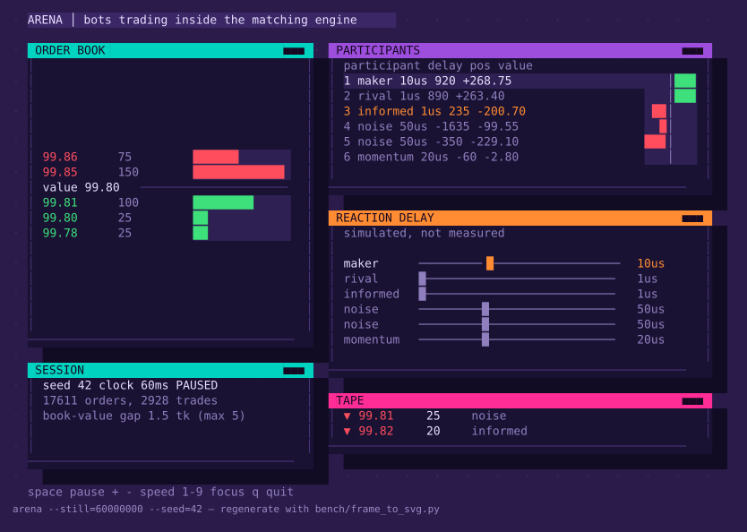

# exchange-lab

**A simulated market you can re-run exactly, on a real exchange matching engine, in your
terminal.** Write a trading strategy, drop it into the market, and find out where its
money comes from and whether the result is real or noise.

For **students** learning how markets work and **researchers** who need experiments they
can control. It is **not a backtester**: the market is invented, and even set to resemble a
real data file it matches three statistics and nothing else, so what a strategy earns here
says nothing about what it would earn on a real venue. Use
it to understand *why* a strategy makes or loses money, not to decide whether to trade it.

## Start here

You need a C++20 compiler and make: g++ 13 or newer on Linux and Windows, or Apple clang 15
on macOS (Apple silicon). Nothing else.

```bash
git clone https://github.com/PhillysTheBest/exchange-lab.git
cd exchange-lab
make app                      # Windows: mingw32-make app, in MSYS2 UCRT64; macOS: make app
build/release/exchange-lab    # run it from the repository root
```

You get a prompt. Try these four commands:

```
> /learn 1                                  # the first of nine guided exercises
> /add examples/strategies/imbalance.hpp    # install a strategy: one C++ header
> /compare imbalance smoke                  # score it on 4 seeds against an empty seat
> /watch imbalance                          # watch it trade live; q comes back
```

`/compare` ends with the verdict. This is an excerpt, with some columns left out:

```
  arm vs baseline          | mean +- s.e.       | 95% interval         | verdict
  imbalance vs placebo     |   -28.32 +-  11.23 |   -64.05 ..    +7.40 | not separated
```

On 4 seeds the example strategy loses about 28 a session, but the interval includes zero, so
nothing is established. On the full 64 seeds (`/compare imbalance`) the loss is
−34.92 ± 3.09 and it separates. That gap between "a number" and "a result" is what the
project is built to show.

### Commands

| Command | What it does |
|---|---|
| `/learn [N]` | the guided exercises, from one order book to a strategy of your own |
| `/strategies` | the built-in strategies, and the ones you installed |
| `/add PATH` | install a strategy of your own |
| `/compare NAME[,NAME...] [smoke\|holdout] [wide\|busy\|all\|market=M]` | score strategies in the same seat of the same market, and print the report; tune on the standard block, confirm once on `holdout` |
| `/runs`, `/report [RUN]` | list your runs; show one's report |
| `/reproduce [RUN]` | re-run a run from its own record and compare every file |
| `/watch [NAME,...] [seed=N]` | watch the market trade live, full screen |
| `/sweep FLAGS` | run one market many times, changing one thing |
| `/data add FILE`, `/data show NAME` | bring a market data file you have in as a tape, and see what it holds |
| `/calibrate NAME` | set the simulated market to resemble a tape, behind a known-answer control |
| `/replay NAME [STRATEGY]` | play an order-by-order tape back through the engine, with one strategy in it |
| `/controls` | check the evaluator itself against answers known in advance |
| `/book` | an order book you drive by hand |
| `/help [command]`, `/quit` | explain a command; leave |

It feels like Claude Code: one prompt, tab completion and history. There is no AI model in
it, no browser and no network. Each command runs one of the project's programs, so the app
can never show a number those programs would not print. `exchange-lab -c '/compare maker
smoke'` runs a single command for scripts. [`docs/APP.md`](docs/APP.md) is the design.



That frame is `/watch still=60000000 seed=42`, drawn from a seed rather than screenshotted,
so anyone can regenerate it and diff it.

## The first result is a negative one

The market was built to ask what 10 microseconds of reaction speed is worth to a market
maker. The answer changed twice:

- **10 µs: not established.** The paired difference is −39.96 ± 56.19, smaller than the
  ±157 that 24 seeds can resolve. That is "underpowered", not "nothing there".
- **1 ms costs real money, −3117.13 ± 74.71 a session, but not through adverse
  selection.** Remove the informed trader and 96% of the cost remains. The slow maker loses
  order flow to the fast one, not information to the informed trader.
- **A second control failed outright.** No maker stale enough to be reliably picked off
  keeps the book tracking the true value, so the post-fill measure could not be calibrated.
  The failure is published.

How a plausible story gets tested and overturned is the lesson, more than any number. The
tables are in [`docs/RESULTS.md`](docs/RESULTS.md) and the reasoning in
[`docs/ARENA.md`](docs/ARENA.md). Every arena number is simulated, and
`bench/summarize_arena.py` prints each one from the committed evidence in `results/`.

## What makes it different

Like agent-based simulators such as ABIDES, it is a market of simulated participants, not a
replay of history. What it adds:

- **A real matching engine.** Price-time priority, self-trade prevention, p99.9 service time
  under 2 µs. Strategies see the book only through its event stream, as on a real venue.
- **A referee.** Every strategy gets the same seat, the same market and the same seeds,
  beside a placebo arm whose seat never acts. Comparisons are paired, with standard errors,
  and a market that has come loose from its true value is refused.
- **A tested evaluator.** Eight controls with answers known in advance, each with a planted
  bug in the tests that makes it fail.
- **Reproduction you can check.** `/reproduce` compares every output file byte for byte, and
  the published results are identical on Windows and Linux. CI checks a record of hashes,
  fingerprints and run files on Linux, Windows and macOS, x86-64 and ARM64
  ([`docs/PLATFORMS.md`](docs/PLATFORMS.md)).

## For students

- `/book` to place orders by hand and see price-time priority and partial fills.
- `/watch` to see a whole market: two makers, an informed trader, noise traders and momentum.
- `/add` and `/compare` to write a strategy and learn where its profit really comes from:
  spread earned, the price move after each fill, carry to the close, and who paid for it.
- `/learn` takes you through all of it in nine exercises; every command in them was run as
  written. [`GLOSSARY.md`](GLOSSARY.md) defines every term.

## For researchers

- **Fixed conditions.** The standard suite is fingerprinted and pinned; two runs are
  comparable only if their fingerprints match. Scenario families (`wide`, `busy`) are
  reported side by side, never pooled.
- **Honest statistics.** Paired differences with intervals, the smallest effect a seed count
  can resolve, a count of interval tests with a Holm correction across the value comparisons,
  and a measured noise floor of about ±2 a session.
- **A floor and a holdout.** `zi`, a zero-intelligence strategy, is the baseline a candidate
  has to beat, not just the empty seat. Tune on the standard seeds, then confirm once on the
  `holdout` block, which no example touches.
- **Known limits.** One instrument, one informed trader, no second venue, no quote fade, and
  a thin book. Results are statements about this instrument, not about trading.
  [`docs/RUNNER.md`](docs/RUNNER.md#known-weaknesses) lists the runner's own weaknesses.
- **Your own data, read from disk, never fetched.** LOBSTER, Databento, Nasdaq ITCH, Tardis,
  Binance, Coinbase, Kraken or any CSV. Calibrate a market to resemble a file, with a
  known-answer control behind the calibration, or replay an order-by-order file through the
  engine, labelled as unable to react. [`docs/DATA.md`](docs/DATA.md) is the design.

Start with [`docs/ARENA.md`](docs/ARENA.md), then [`docs/RUNNER.md`](docs/RUNNER.md),
[`docs/REPORT.md`](docs/REPORT.md) and [`docs/CONTROLS.md`](docs/CONTROLS.md).

## The engine underneath

A single-threaded matching core fed by a lock-free ring, with no heap allocation after
start-up and fixed-point prices. These numbers are **measured on hardware** (i5-12450H laptop,
Windows 11, five 1M-order streams per book), unlike the arena's, which are simulated:

| Book | p50 | p99.9 | Under 2 µs | Slowest order |
|---|---|---|---|---|
| Deep (about 1,500 price levels per side) | 278 ns | 1.2 µs | 99.95% | 158 µs |
| Thin | 154 ns | 891 ns | 99.96% | — |

Replays are bit-identical on Windows and Linux. [`docs/ENGINE.md`](docs/ENGINE.md) has the
design, the measurement method, the slow tail and the correctness tests.

## Without the app

Every command is also a `make` target or a program:

```bash
make test                     # all 9 test programs
make test-cli test-lab test-app test-data
make strategy STRATEGY=examples/strategies/imbalance.hpp
make compare CANDIDATES=imbalance,maker
make reproduce RUN=runs/imbalance-vs-maker-standard
make controls
make data FILE=examples/data/DEMO_2012-06-21_34200000_57600000_message_3.csv
make calibrate TAPE=name      # then make compare CANDIDATES=a MARKET=name
make replay TAPE=demo-2012-06-21 STRATEGY=maker
make bench                    # the engine's benchmarks
```

## Scope

**Not built, on purpose:** a browser or desktop interface, an AI model, live trading, a
network connection of any kind (data files are read from disk, never fetched), order amend,
stop orders and auctions.

## Layout

| Path | Contents |
|---|---|
| `app/` | the terminal app |
| `include/px/`, `src/` | the matching engine |
| `arena/` | the simulated market, its strategies, the runner, the controls and the viewer |
| `marketdata/` | your own data: the tape, the importers, calibration and replay |
| `examples/` | a complete strategy of your own to copy, and made-up data files to import |
| `tests/`, `bench/`, `results/` | tests, benchmarks, and the committed evidence behind every number |
| `docs/` | [`LEARN`](docs/LEARN.md), [`APP`](docs/APP.md), [`ARENA`](docs/ARENA.md), [`RESULTS`](docs/RESULTS.md), [`RUNNER`](docs/RUNNER.md), [`REPORT`](docs/REPORT.md), [`CONTROLS`](docs/CONTROLS.md), [`REPRODUCE`](docs/REPRODUCE.md), [`DATA`](docs/DATA.md), [`ENGINE`](docs/ENGINE.md), [`PLATFORMS`](docs/PLATFORMS.md) |

## Licence, citation and issues

Apache License 2.0 ([`LICENSE`](LICENSE), [`NOTICE`](NOTICE)). The licence covers the whole
repository: the code, the documentation, the committed evidence and the sample data files in
`examples/data/`, which were made up by hand. To cite exchange-lab, use
[`CITATION.cff`](CITATION.cff) (GitHub shows it as "Cite this repository"); cite a tagged
release, not `main`. Questions and bugs go in
[GitHub Issues](https://github.com/PhillysTheBest/exchange-lab/issues), and
[`CONTRIBUTING.md`](CONTRIBUTING.md) sets out the rules a change has to keep.
