# exchange-lab

**A simulated market you can re-run exactly, on a real exchange matching engine, in your
terminal.** Write a trading strategy, drop it into the market, and find out where its
money comes from and whether the result is real or noise.

For **students** learning how markets work and **researchers** who need experiments they
can control. It is **not a backtester**: the market is invented, and even set to resemble a
real data file it matches three statistics and nothing else, so what a strategy earns here
says nothing about what it would earn on a real venue. Use
it to understand *why* a strategy makes or loses money, not to decide whether to trade it.

## Start here

You need a C++20 compiler and make: g++ 13 or newer on Linux and Windows, or Apple clang 15
on macOS (Apple silicon). Nothing else.

```bash
git clone https://github.com/PhillysTheBest/exchange-lab.git
cd exchange-lab
make app                      # Windows: mingw32-make app, in MSYS2 UCRT64; macOS: make app
build/release/exchange-lab    # run it from the repository root
```

You get a prompt. Try these four commands:

```
> /learn 1                                  # the first of eleven guided exercises
> /add examples/strategies/imbalance.hpp    # install a strategy: one C++ header
> /compare imbalance smoke                  # score it on 4 seeds against an empty seat
> /watch imbalance                          # watch it trade live; q comes back
```

New to it? [Step by step: your first hour](#step-by-step-your-first-hour) walks through
every command with a picture of what you should see.

`/compare` ends with the verdict. This is an excerpt, with some columns left out:

```
  arm vs baseline          | mean +- s.e.       | 95% interval         | verdict
  imbalance vs placebo     |   -28.32 +-  11.23 |   -64.05 ..    +7.40 | not separated
```

On 4 seeds the example strategy loses about 28 a session, but the interval includes zero, so
nothing is established. On the full 64 seeds (`/compare imbalance`) the loss is
−34.92 ± 3.09 and it separates. That gap between "a number" and "a result" is what the
project is built to show.

### Commands

| Command | What it does |
|---|---|
| `/learn [N]` | the guided exercises, from one order book to a strategy of your own |
| `/strategies` | the built-in strategies, and the ones you installed |
| `/add PATH` | install a strategy of your own |
| `/compare NAME[,NAME...] [smoke\|holdout] [wide\|busy\|all\|sensitivity\|market=M\|suite=S]` | score strategies in the same seat of the same market, and print the report; tune on the standard block, confirm once on `holdout`; `suite=S` runs a suite of your own, written in a file |
| `/runs`, `/report [RUN]` | list your runs; show one's report |
| `/reproduce [RUN]` | re-run a run from its own record and compare every file |
| `/watch [NAME,...] [seed=N]` | watch the market trade live, full screen |
| `/sweep FLAGS` | run one market many times, changing one thing |
| `/data add FILE`, `/data show NAME` | bring a market data file you have in as a tape, and see what it holds |
| `/calibrate NAME [holdback=PCT]` | set the simulated market to resemble a tape, behind a known-answer control; `holdback=30` checks the fit on the part it never saw |
| `/facts NAME` | the stylised facts calibration does not fit, the tape's beside the simulated market's |
| `/replay NAME [STRATEGY]` | play an order-by-order tape back through the engine, with one strategy in it |
| `/controls` | check the evaluator itself against answers known in advance |
| `/book` | an order book you drive by hand |
| `/help [command]`, `/quit` | explain a command; leave |

It feels like a coding agent's terminal: one prompt, tab completion and history. There is no AI model in
it, no browser and no network. Each command runs one of the project's programs, so the app
can never show a number those programs would not print. `exchange-lab -c '/compare maker
smoke'` runs a single command for scripts. [`docs/APP.md`](docs/APP.md) is the design.

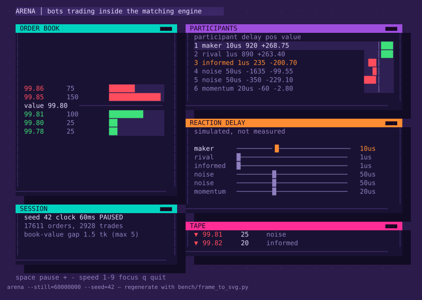

That frame is `/watch still=60000000 seed=42`, drawn from a seed rather than screenshotted,
so anyone can regenerate it and diff it.

## The first result is a negative one

The market was built to ask what 10 microseconds of reaction speed is worth to a market
maker. The answer changed twice:

- **10 µs: not established.** The paired difference is −39.96 ± 56.19, smaller than the
  ±157 that 24 seeds can resolve. That is "underpowered", not "nothing there".
- **1 ms costs real money, −3117.13 ± 74.71 a session, but not through adverse
  selection.** Remove the informed trader and 96% of the cost remains. The slow maker loses
  order flow to the fast one, not information to the informed trader.
- **A second control failed outright.** No maker stale enough to be reliably picked off
  keeps the book tracking the true value, so the post-fill measure could not be calibrated.
  The failure is published.

How a plausible story gets tested and overturned is the lesson, more than any number. The
tables are in [`docs/RESULTS.md`](docs/RESULTS.md) and the reasoning in
[`docs/ARENA.md`](docs/ARENA.md). Every arena number is simulated, and
`bench/summarize_arena.py` prints each one from the committed evidence in `results/`.

## What makes it different

Like agent-based simulators such as ABIDES, it is a market of simulated participants, not a
replay of history. What it adds:

- **A real matching engine.** Price-time priority, self-trade prevention, p99.9 service time
  under 2 µs. Strategies see the book only through its event stream, as on a real venue.
- **A referee.** Every strategy gets the same seat, the same market and the same seeds,
  beside a placebo arm whose seat never acts. Comparisons are paired, with standard errors,
  and a market that has come loose from its true value is refused.
- **A tested evaluator.** Eight controls with answers known in advance, each with a planted
  bug in the tests that makes it fail.
- **Reproduction you can check.** `/reproduce` compares every output file byte for byte, and
  the published results are identical on Windows and Linux. CI checks a record of hashes,
  fingerprints and run files on Linux, Windows and macOS, x86-64 and ARM64
  ([`docs/PLATFORMS.md`](docs/PLATFORMS.md)).

## For students

- `/book` to place orders by hand and see price-time priority and partial fills.
- `/watch` to see a whole market: two makers, an informed trader, noise traders and momentum.
- `/add` and `/compare` to write a strategy and learn where its profit really comes from:
  spread earned, the price move after each fill, carry to the close, and who paid for it.
- `/learn` takes you through all of it in eleven exercises: the tenth is a whole study from
  hypothesis to holdout, the eleventh a strategy's settings and a suite of your own; every command in them was run as
  written. [`GLOSSARY.md`](GLOSSARY.md) defines every term.

## For researchers

- **Fixed conditions.** The standard suite is fingerprinted and pinned; two runs are
  comparable only if their fingerprints match. Scenario families (`wide`, `busy`) are
  reported side by side, never pooled.
- **Honest statistics.** Paired differences with intervals, the smallest effect a seed count
  can resolve, a count of interval tests with a Holm correction across the value comparisons,
  and a measured noise floor of about ±2 a session.
- **A floor, a holdout and a sensitivity grid.** `zi`, a zero-intelligence strategy, is the
  baseline a candidate has to beat, not just the empty seat. Tune on the standard seeds,
  confirm once on the `holdout` block, which no example touches, and ask whether the result
  survives a fixed grid of changed conditions (`/compare NAME sensitivity`).
- **Conditions of your own, kept as strict.** A strategy's settings go on its name
  (`imbalance+ratio=5`) and are recorded with the run. A different market, line-up, session
  length or seed block is a suite file: it has its own fingerprint, is admitted only if its
  placebo passes the health gate, and reproduces from the run's record without the file
  ([`docs/RUNNER.md`](docs/RUNNER.md#a-suite-of-your-own)).
- **Known limits.** One instrument, one informed trader, no second venue, no quote fade, and
  a thin book. Results are statements about this instrument, not about trading.
  [`docs/RUNNER.md`](docs/RUNNER.md#known-weaknesses) lists the runner's own weaknesses.
- **Your own data, read from disk, never fetched.** LOBSTER, Databento, Nasdaq ITCH, Tardis,
  Binance, Coinbase, Kraken or any CSV. Calibrate a market to resemble a file, with a
  known-answer control behind the calibration, or replay an order-by-order file through the
  engine, labelled as unable to react. [`docs/DATA.md`](docs/DATA.md) is the design.

Start with [`docs/ARENA.md`](docs/ARENA.md), then [`docs/RUNNER.md`](docs/RUNNER.md),
[`docs/REPORT.md`](docs/REPORT.md) and [`docs/CONTROLS.md`](docs/CONTROLS.md).

## Step by step: your first hour

A path through the app for someone who has never used it, from the first prompt to a result
you can defend. Each step has the command to type and a picture of the real screen. The
pictures were recorded from the app on Linux and are its own output, unedited; on Windows the
programs end in `.exe` and the compiler's notices in step 5 do not appear.

### 1. Build it and see what it can do

```bash
make app                      # Windows: mingw32-make app, in MSYS2 UCRT64
build/release/exchange-lab    # always from the repository root
```

At the prompt, type `/help`. Every command is listed with one line on what it is for. Tab
completes a command, up and down recall earlier lines, and Ctrl-C stops a running command
without leaving the app.

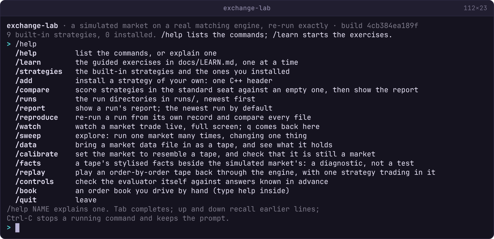

### 2. Follow the first exercise

`/learn` lists the guided exercises and `/learn 1` opens the first. Each gives a goal, the
commands to type, what to look for and a question to think about. They run from one order book
to a complete study, and every command in them was run as written.

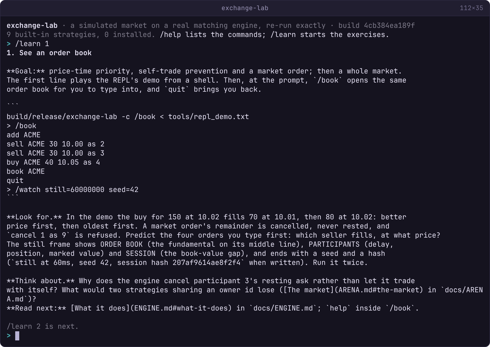

### 3. Drive an order book by hand

`/book` gives you the matching engine on its own. Add an instrument, then place orders as
different participants (`as 2`, `as 3`) and watch the rules play out: the better price trades
first, then the older order; a market order's unfilled part is cancelled; a cancel from the
wrong owner is refused; and an order that would trade with its owner's own resting order
cancels that order instead. `amend ID PRICE QTY as OWNER` changes a resting order: smaller at
the same price keeps its place in the queue, anything else sends it to the back. `auction SYM`
stops matching so orders can cross, and `uncross SYM` then matches them all at the single
price that trades the most. Type `help`
inside for the full list, and `quit` to return.

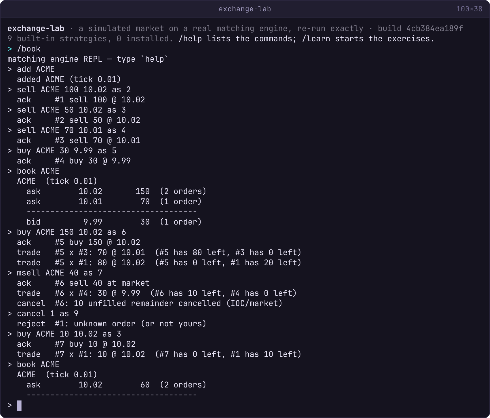

### 4. Watch a whole market trade

`/watch imbalance seed=42` opens the live viewer: the order book with the hidden true value on
its middle line, each participant's position and running value, the reaction delay each was
given, and the trades as they print. The same seed always plays the same session. `space`
pauses, `+` and `-` change the speed, and `q` brings you back to the prompt. (Run step 5 first
if `imbalance` is not installed yet, or use plain `/watch`.)

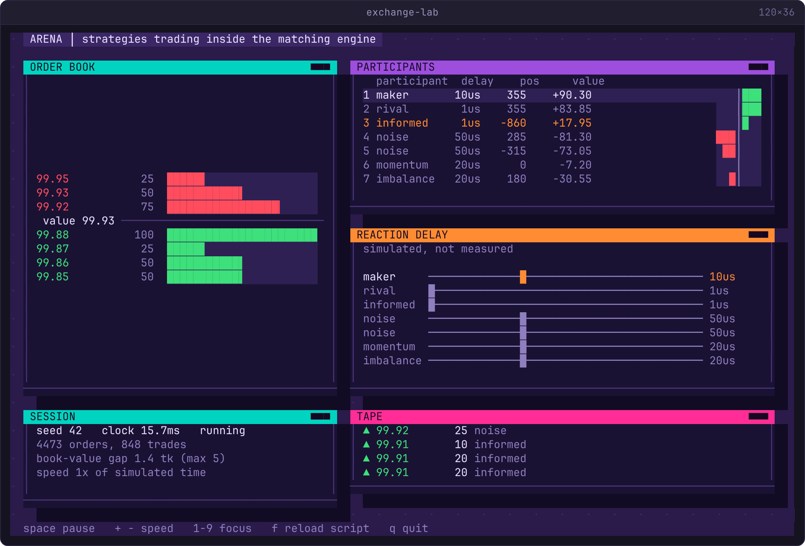

Press a number key to follow one participant everywhere on the screen; here it is 7, the
strategy you are about to install. The keys change only what is shown, never what happens.

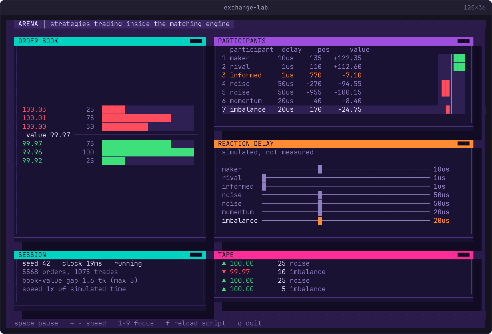

### 5. Install a strategy of your own

A strategy is one C++ header. `/add examples/strategies/imbalance.hpp` checks the file, copies
it in and rebuilds the lab programs; `/strategies` then lists it beside the built-in ones. An
installed strategy reaches only the lab programs, never the ones behind the published results.
To write your own, copy that file: it is the worked example.

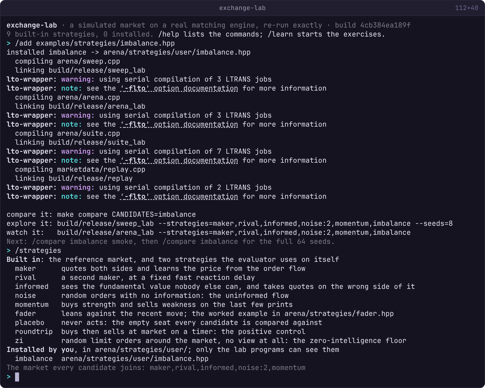

### 6. Score it

`/compare imbalance smoke` puts the strategy in one seat of the reference market on four fixed
seeds, beside a placebo arm whose seat never acts. Read the report from the top: first whether
every session was still a healthy market, then the seat's value, then the paired comparison and
its verdict, then where the money came from (spread earned, the price move after each fill,
carry to the close) and which participants paid for it. Four seeds only show that a strategy
runs; `/compare imbalance` runs the full sixty-four.

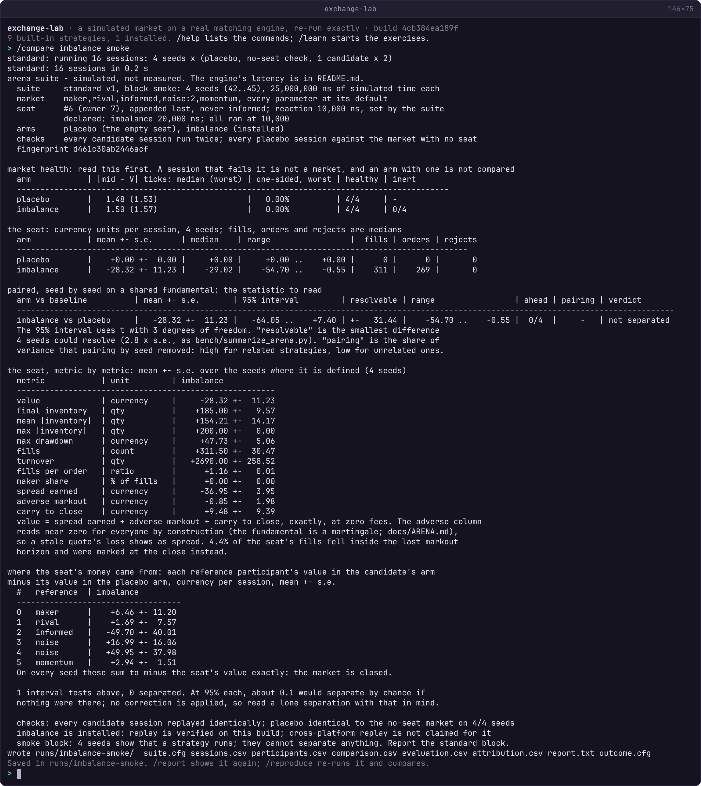

### 7. Check that the result reproduces

`/reproduce imbalance-smoke` rebuilds the run from the record it saved and compares every file
it wrote, byte for byte. `/runs` lists your runs and `/report` shows one again.

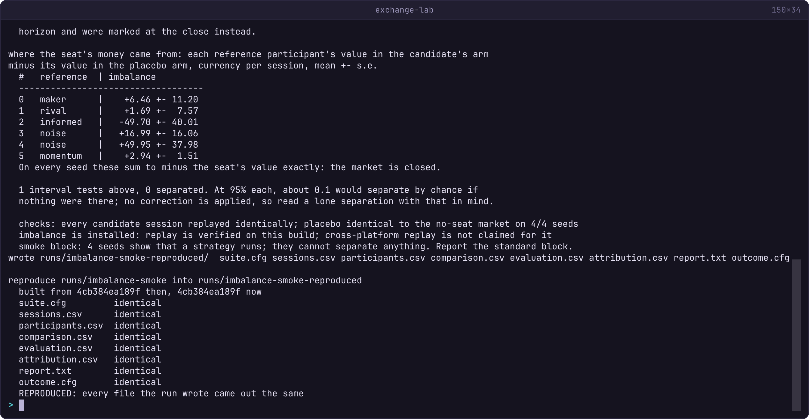

### 8. Check the evaluator itself

`/controls smoke` runs the controls whose answers are known in advance: an empty seat must
score exactly zero, two copies of one strategy must tie, a tiny change must not look like a
real difference, and a strategy built to lose money must be seen to lose it.

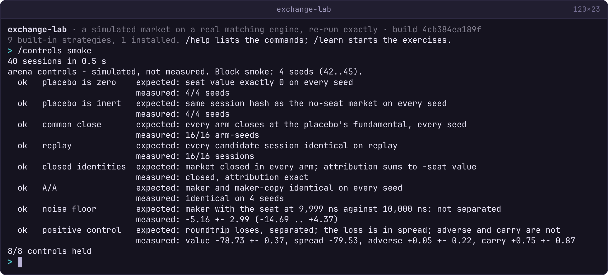

### 9. Ask your own question

`/sweep` changes one thing across many seeds. `/sweep --seeds=8` repeats the project's
headline experiment on a small scale: the market maker's reaction delay is changed step by
step, the report first checks that every setting is still a market, then reads the difference
seed by seed and says plainly whether it is established. `/sweep --help` lists every field you
can change.

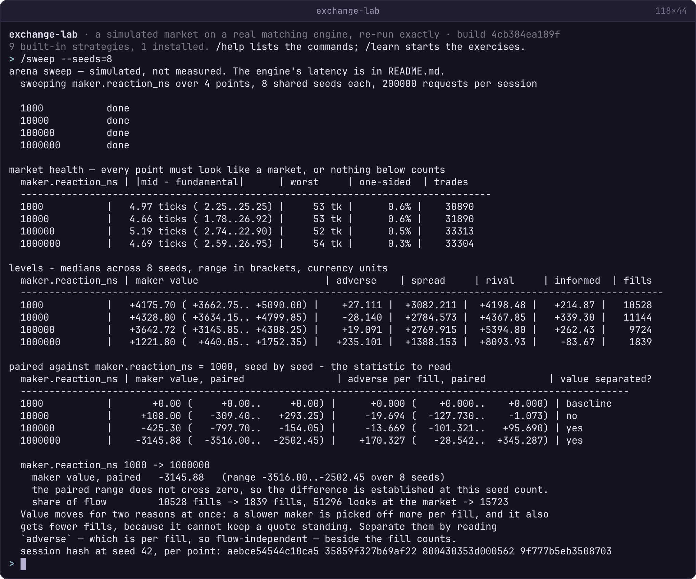

### 10. Bring in your own data

`/data add FILE` reads a market data file you already have (LOBSTER, Databento, Nasdaq ITCH,
Tardis, Binance, Coinbase, Kraken or CSV), converts it once into a tape and says what it holds.
Nothing is ever downloaded. The sample below is made up for the project, and the app says so.

```
> /data add examples/data/DEMO_2012-06-21_34200000_57600000_message_3.csv
```

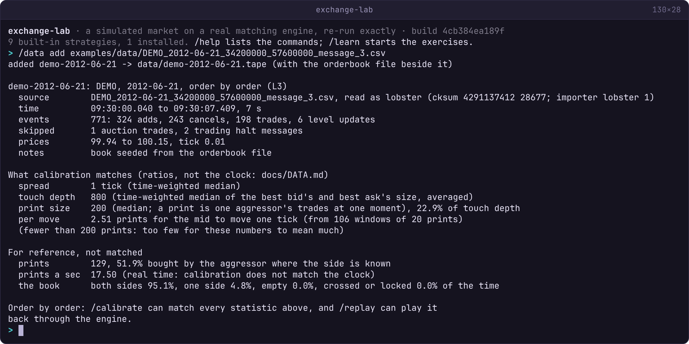

### 11. Replay history through the engine

`/replay demo-2012-06-21 maker` plays the recorded orders back through the real engine with one
strategy trading among them. The screen opens with the limit of the method: history cannot
react to the strategy, so the result is the most the recorded flow could have given, not what
would have happened.

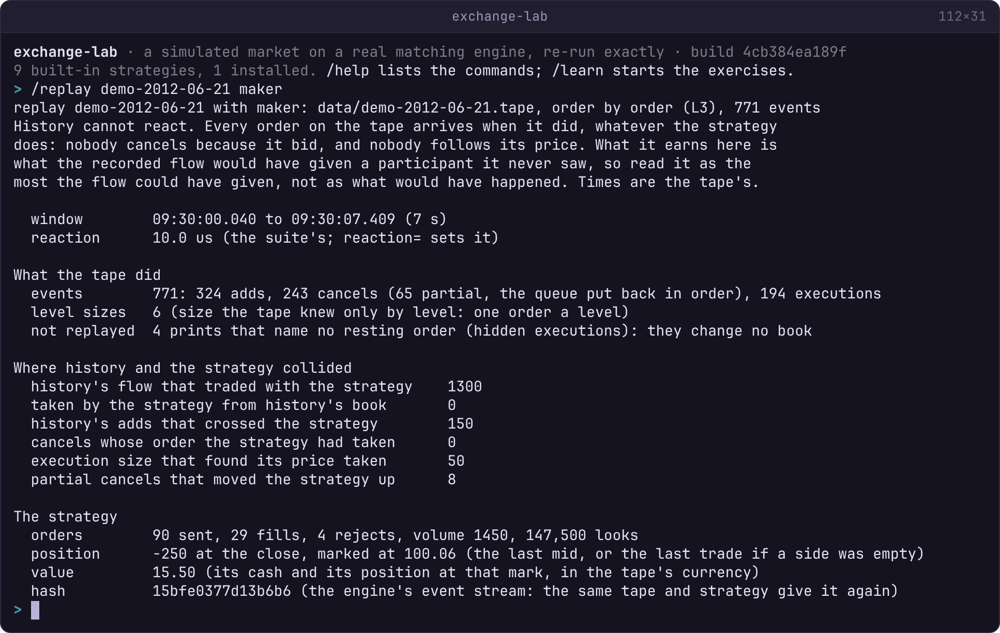

### 12. Set the market to resemble a tape

`/calibrate NAME` adjusts the simulated market until three of its statistics match the tape's.
It runs a test with a known answer before it trusts the result, says when other settings would
fit the data just as well, checks that the result is still a healthy market, and prints the
statistics it did not fit beside the tape's. The sample in step 10 is too short to calibrate
from and is refused, so the picture first writes a tape whose answer is known
(`/calibrate --known=known`) and then calibrates to it (`/calibrate known`). Afterwards,
`/compare STRATEGY market=known` runs the standard experiment on the calibrated market.

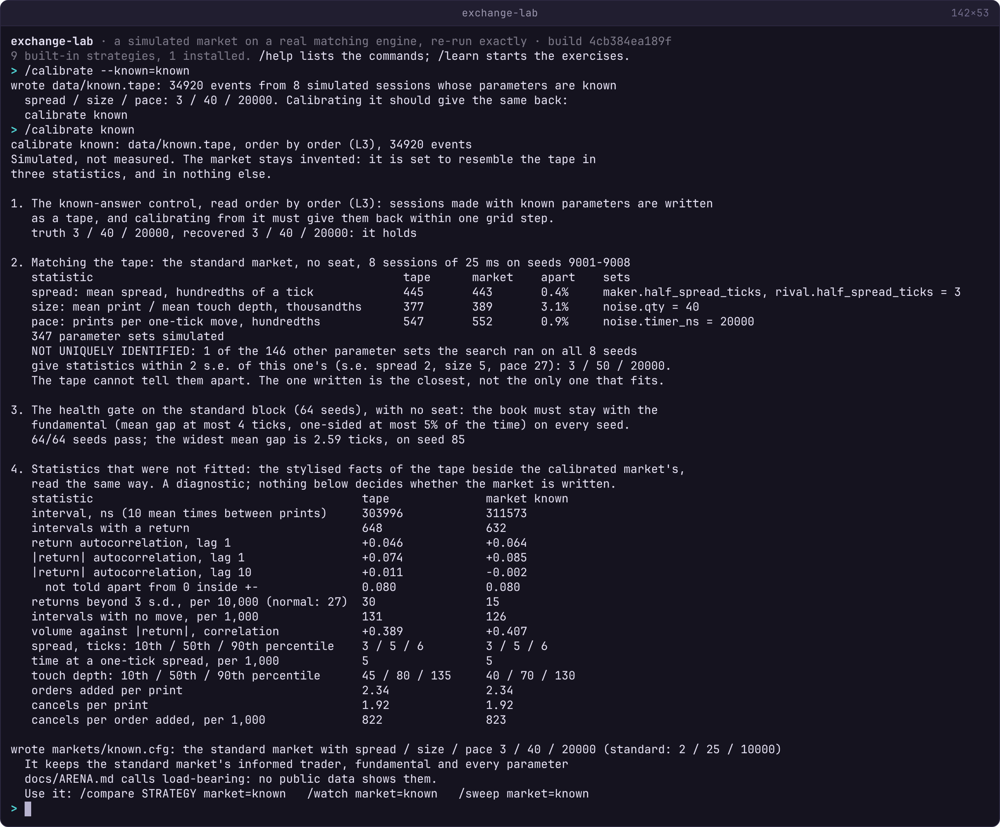

### Where next

[`docs/LEARN.md`](docs/LEARN.md) has the remaining exercises, including a whole study from
hypothesis to holdout. [`GLOSSARY.md`](GLOSSARY.md) defines every term the reports use.
[`docs/VENUE.md`](docs/VENUE.md) is the place to start if your interest is the exchange
itself rather than strategies.

## The engine underneath

A single-threaded matching core fed by a lock-free ring, with no heap allocation after
start-up and fixed-point prices. These numbers are **measured on hardware** (i5-12450H laptop,
Windows 11, five 1M-order streams per book), unlike the arena's, which are simulated:

| Book | p50 | p99.9 | Under 2 µs | Slowest order |
|---|---|---|---|---|
| Deep (about 1,500 price levels per side) | 278 ns | 1.2 µs | 99.95% | 158 µs |
| Thin | 154 ns | 891 ns | 99.96% | — |

Replays are bit-identical on Windows and Linux. [`docs/ENGINE.md`](docs/ENGINE.md) has the
design, the measurement method, the slow tail and the correctness tests.

## Around the engine: the venue

A matching engine is only the middle of an exchange. [`venue/`](docs/VENUE.md) builds the
stages around it, each in one header with a test that checks it, and none of them changes the
engine's rules:

- **a sequencer** that puts many senders into one order, drops resends and refuses gaps, and
  shares turns fairly between sessions;
- **a pre-trade risk gate** with size and value limits, a price collar, a cap on open orders,
  a message throttle and a **kill switch** that pulls every order a member has resting;
- **a journal and snapshots**, so a crashed engine is rebuilt to exactly the event stream it
  would have produced, and **a hot standby** that follows the journal and can take over;
- **a public market data feed** kept apart from each member's private reports, anonymous and
  order by order, numbered so a listener can detect a gap and recover from a snapshot;
- **order amend**, keeping time priority only when an order is made smaller at the same price,
  and **a batch auction** that collects orders, then matches them all at the one price that
  trades the most;
- **instruments sharded** across matcher threads, each shard provably the same as running it
  alone;
- **per-stage time stamps** in the benchmark, kept apart from the published service time;
- **an order-entry protocol** and one loopback demonstration (`make test-net`): two clients and
  a venue on this machine, with logon, resends, cancel on disconnect and reconnect, every step
  checked.

## Without the app

Every command is also a `make` target or a program:

```bash
make test                     # every test program, including the venue's
make test-cli test-lab test-app test-data
make strategy STRATEGY=examples/strategies/imbalance.hpp
make compare CANDIDATES=imbalance,maker
make reproduce RUN=runs/imbalance-vs-maker-standard
make controls
make data FILE=examples/data/DEMO_2012-06-21_34200000_57600000_message_3.csv
make calibrate TAPE=name      # then make compare CANDIDATES=a MARKET=name
make replay TAPE=demo-2012-06-21 STRATEGY=maker
make bench                    # the engine's benchmarks
make test-net                 # the venue on the loopback address (Linux and macOS)
```

## Scope

A coding agent can write a strategy and read a report beside the app
([`docs/CODING-AGENT.md`](docs/CODING-AGENT.md)); a model trained elsewhere can run frozen into
integers ([`examples/frozen/`](examples/frozen/README.md)). No model is ever called from a session.

**Not built, on purpose:** a browser or desktop interface, an AI model, live trading, a
network connection to anything outside the machine (data files are read from disk, never
fetched), and stop orders. The one socket in the repository is the venue's loopback
demonstration, which never leaves `127.0.0.1` and produces no evidence.

## Layout

| Path | Contents |
|---|---|
| `app/` | the terminal app |
| `include/px/`, `src/` | the matching engine |
| `venue/` | the stages around the engine: sequencer, risk gate, journal and recovery, feed, shards, wire protocol |
| `arena/` | the simulated market, its strategies, the runner, the controls and the viewer |
| `marketdata/` | your own data: the tape, the importers, calibration and replay |
| `examples/` | a complete strategy of your own to copy, a frozen learned model, and made-up data files to import |
| `tests/`, `bench/`, `results/` | tests, benchmarks, and the committed evidence behind every number |
| `docs/` | [`LEARN`](docs/LEARN.md), [`CODING-AGENT`](docs/CODING-AGENT.md), [`APP`](docs/APP.md), [`ARENA`](docs/ARENA.md), [`RESULTS`](docs/RESULTS.md), [`RUNNER`](docs/RUNNER.md), [`REPORT`](docs/REPORT.md), [`CONTROLS`](docs/CONTROLS.md), [`REPRODUCE`](docs/REPRODUCE.md), [`DATA`](docs/DATA.md), [`ENGINE`](docs/ENGINE.md), [`VENUE`](docs/VENUE.md), [`PLATFORMS`](docs/PLATFORMS.md) |

## Licence, citation and issues

Apache License 2.0 ([`LICENSE`](LICENSE), [`NOTICE`](NOTICE)). The licence covers the whole
repository: the code, the documentation, the committed evidence and the sample data files in
`examples/data/`, which were made up by hand. To cite exchange-lab, use
[`CITATION.cff`](CITATION.cff) (GitHub shows it as "Cite this repository"); cite a tagged
release, not `main`; [`CHANGELOG.md`](CHANGELOG.md) says what each release changed and which
fingerprints moved. Questions and bugs go in
[GitHub Issues](https://github.com/PhillysTheBest/exchange-lab/issues), and
[`CONTRIBUTING.md`](CONTRIBUTING.md) sets out the rules a change has to keep.
