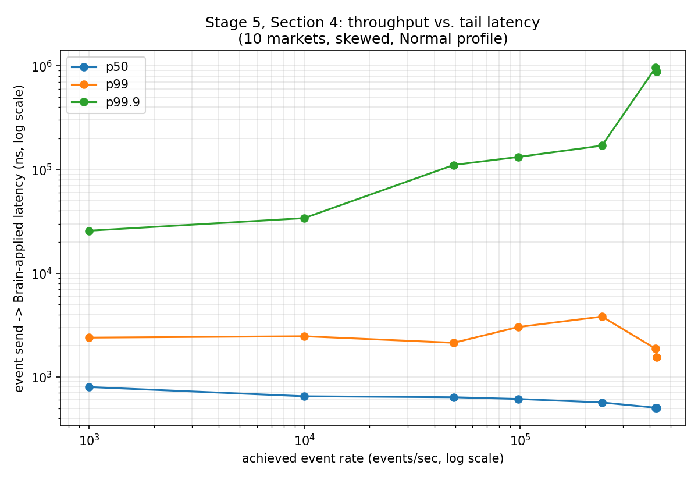
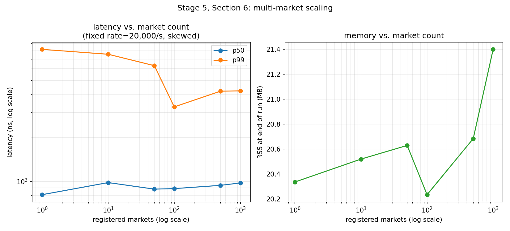

# Performance report

A single-document account of every latency number this project has produced,
how each one was measured, what optimization it's attached to, and — just as
important — which comparisons this report deliberately does **not** make,
because they were never actually run. See [README.md](../README.md) for the
system's architecture and correctness story; this document is about speed
and the discipline behind claiming it.

## How to read this

- **Every number below is p50/p90/p99/p99.9(/p99.99), never a mean.** A mean
  hides exactly the outliers — a mispredicted branch cascading into a TLB
  miss, an OS scheduler preemption — that determine whether a trading
  decision beats the market or arrives after it's already moved. See
  [`px/histogram.hpp`](../include/px/histogram.hpp).
- **Timed with `rdtscp`** ([`px/tsc_clock.hpp`](../include/px/tsc_clock.hpp)),
  calibrated once against `std::chrono::steady_clock`, with the
  invariant-TSC bit checked (CPUID leaf `0x80000007`, EDX bit 8) rather than
  assumed — every benchmark below prints `invariant TSC: yes` before its
  numbers, confirming the clock is trustworthy on this run.
- **Machine**: a mobile-TDP laptop chip (Intel i5-12450H, hybrid 4P+4E
  cores), Windows 11, no `isolcpus`, no tuned bare-metal box. Every benchmark
  that can pin does (`pin_current_thread_to` + `THREAD_PRIORITY_TIME_CRITICAL`
  — [`src/platform_win32.cpp`](../src/platform_win32.cpp)), but this is a
  laptop, not a colo cage, and the numbers below should be read as "what a
  reasonable but unglamorous machine gets," not a performance ceiling.
- **All numbers in this document come from one coherent build/run** (`mingw32-make
  clean && mingw32-make all && mingw32-make test-live && mingw32-make live &&
  mingw32-make bench-live`, immediately in sequence), not stitched together
  from different sessions run under different conditions. They will drift
  run to run on any machine, this one included — re-run the `Makefile`
  targets listed with each section yourself rather than trusting numbers
  frozen in a document.

## Architecture at a glance

```
Offline:  Order/OrderBook/Trade/Market/Trader/MatchingEngine  (array ladder, O(1) match)
Live:     Kalshi --TLS/WS--> [T1 Ingress] --ring A--> [T2 Brain] --ring B--> [T3 Gateway] --REST--> Kalshi
                                                            ^                     |
                                                            +-------ring C--------+
Decision: Strategy::on_event(MarketState, TriggerKind, OracleEvent*) -> Join/Improve/Cross/Cancel/Wait
```

Full detail in [README.md](../README.md)'s Architecture section and
[CLAUDE.md](CLAUDE.md).

## The optimization journey

Six named techniques, each adopted for a specific, statable reason. The
**Evidence** column is deliberately precise about what was and wasn't
isolated with a controlled measurement — a technique's contribution is
sometimes a clean before/after number, and sometimes it's "baked into" the
combined-system numbers in the next section with no individual attribution
claimed, because that specific A/B experiment was never run. Claiming a
number for the second kind would be exactly the sort of unverified assumption
this project's whole benchmarking philosophy exists to push back against.

| # | Technique | Problem it solves | Evidence |
|---|---|---|---|
| 1 | **Array price ladder + occupancy bitmasks** ([`order_book.hpp`](../include/px/order_book.hpp)) instead of a sorted tree of price levels | Best bid/ask is a `countl_zero`/`countr_zero` over two 64-bit words, not a tree descent; a price is a direct array index, not a comparison-based lookup | Architectural choice, not independently isolated — see "The comparison we didn't make," below. Reflected only in the combined `submit`/`cancel` numbers in the next section |
| 2 | **Object pool, no hot-path `new`** ([`pool.hpp`](../include/px/pool.hpp)) — one contiguous slab, allocated once, an intrusive free list handing out/reclaiming indices | Heap allocation (and its worst case — an allocator lock, a page fault) on every single order is the single most common reason a "fast" matching engine isn't | Architectural choice; not isolated against a `new`-per-order baseline. Reflected in `submit`/`cancel`'s combined numbers |
| 3 | **Hand-rolled open-addressing flat map** ([`flat_map.hpp`](../include/px/flat_map.hpp)) for order-id → slot lookup, with backward-shift deletion | `std::unordered_map` allocates a node per entry — at least one guaranteed cache miss per lookup, on a lookup that happens on every cancel and every fill | Architectural choice; not isolated against `std::unordered_map`. Reflected in `cancel`'s combined number |
| 4 | **Lock-free SPSC ring** ([`spsc_ring.hpp`](../include/px/spsc_ring.hpp)), LMAX-style monotonic cursors, cache-line-padded | Cross-thread handoff (T1→T2→T3, and back) without a mutex, without false sharing between producer/consumer cache lines | **Directly measured**, same-thread vs. cross-core, via `bench_ring` — see below. This is the one technique with its own clean, isolated before/after number |
| 5 | **CPU pinning + `THREAD_PRIORITY_TIME_CRITICAL`** ([`platform_win32.cpp`](../src/platform_win32.cpp)), P-core selection + SMT-sibling skip on this machine's hybrid 4P+4E layout | Removes scheduler migration and P/E-core placement as a source of jitter | Always-on in every pinned benchmark below; never run head-to-head against an unpinned version on this machine, so no isolated number is claimed |
| 6 | **RSA-PSS signing moved off T2 onto its own thread (T3 Gateway)** | Signing is ~15,000–28,000× a book update with a multi-millisecond tail (measured, not assumed) — inline in T2 it would freeze the book mid-update every time an order goes out | **Directly measured** — `bench_sign` vs. `bench_engine`'s submit numbers. The other clean before/after number this report has |

### The comparison we didn't make

[`tests/reference_book.hpp`](../tests/reference_book.hpp) — the deliberately
naive `std::map`+`std::deque`+heap-allocation-throughout book used to
differentially fuzz `OrderBook` for *correctness* (see
[`fuzz_vs_reference.cpp`](../tests/fuzz_vs_reference.cpp), 20,000 iterations, 0
mismatches) — carries its own header comment stating plainly: **"This is
explicitly not the A/B performance twin... that was declined."** This report
honors that decision rather than quietly overriding it to manufacture a
flattering "N× faster than a naive book" headline number. A naive
tree-plus-heap-allocation book losing a speed contest to an array-plus-pool
one would be true and also nearly information-free — the interesting
engineering claim in this project was never "an array beats a tree," it's
the actual measured numbers below, on the actual matching semantics this
book implements.

## Measured results

### Core matching engine — `mingw32-make bench` (`bench_engine`)

```
submit: rest new order        p50=   165.1ns  p90=   224.0ns  p99=   247.2ns  p99.9=   441.2ns
submit: single full cross     p50=   123.4ns  p90=   130.2ns  p99=   174.7ns  p99.9=   226.0ns
submit: 50-level market sweep p50=    52.1ns  p90=  1688.9ns  p99=  2185.3ns  p99.9=  3445.1ns
cancel: resting order         p50=    79.7ns  p90=   118.2ns  p99=   167.5ns  p99.9=   379.0ns
mixed load (rest/cross/cancel)  p50= 158.7ns  p90=   269.3ns  p99=   504.5ns  p99.9=   840.6ns
  throughput: 3,695,814 ops/sec (mixed load)
```

The 50-level sweep's p50/p99 gap (52ns vs. 2,185ns — over 40×) is kept
deliberately visible rather than smoothed into a single "sweep is fast"
number: sweeping more levels is genuinely more work, and reporting only the
best case would be exactly the misleading, cherry-picked claim this whole
methodology exists to avoid.

### Lock-free ring — `mingw32-make bench` (`bench_ring`)

```
same-thread push+pop (no core hop)   p50=    40.5ns   p99=    52.1ns   p99.9=    59.7ns
cross-core round trip (ping-pong)    p50=   627.9ns   p99=   842.3ns   p99.9=  3110.6ns
```

**This is technique #4's isolated number.** ~40ns is the ring's own
bookkeeping (cursor read/write, capacity check); ~628–842ns is what a real
cache-line bounce between two physical cores actually costs on this machine
— the ~15× gap between them is the attributable cost of cross-core
communication, not ring overhead. Measured via a strict one-message-in-flight
ping-pong protocol; see "The methodology bug," below, for why that protocol
exists at all.

### Strategy dispatch — `mingw32-make bench` (`bench_strategy`)

```
extract_features (MarketState assembly)   p50=  34.9ns   p99=  46.9ns
PassiveMarketMaker (quoting)              p50=  41.7ns   p99=  54.5ns
PassiveMarketMaker (managing position)    p50=  42.5ns   p99=  54.5ns
OrderBookImbalance (book-driven)          p50=  43.3ns   p99=  49.3ns
TradeFlow (trade-flow-driven)             p50=  52.9ns   p99=  65.3ns
OracleThresholdStrategy (oracle-driven)   p50=  56.9ns   p99=  66.1ns
```

Every strategy's decision function costs roughly the same order of magnitude
as a single `ShadowBook` level update (~50–165ns, from `bench_engine`
above) — the measured basis for Brain running strategy dispatch inline on
T2 rather than giving it its own thread.

### RSA-PSS signing — `mingw32-make bench-live` (`bench_sign`)

```
RSA-2048 PSS sign_request()   p50= 1,386,790.8ns (~1.39ms)   p99= 2,103,180.0ns (~2.10ms)   max= 6,836,338.9ns
```

**Technique #6's isolated number**, calling the real production
`sign_request` against a throwaway locally-generated key. At p50, that's
roughly **8,400×** a `ShadowBook` update (~165ns) and **~33,000×** a
strategy's own decision cost (~42ns) — the entire, measured justification
for T3 existing as its own thread rather than inline in T2.

### The full internal decision path, end to end — `mingw32-make bench-live` (`bench_pipeline_e2e`)

```
WS frame -> parse -> shadow-book -> features -> strategy -> risk -> OrderIntent
  p50= 3,129.5ns (~3.13µs)   p90= 3,255.7ns   p99= 4,177.7ns   p99.9= 18,656.6ns   max= 408,299.1ns
```

The headline number. Through two real, pinned threads and two real
cross-core ring hops (T1-equivalent parse → ring A → T2 Brain → ring B →
observed), pacing one event through at a time (see below): **~3.1µs at p50**
to turn a raw WS text frame into a routed `OrderIntent` — real JSON parsing,
a real `ShadowBook` mutation, a real `MarketState` assembly, and a real
strategy decision, twice across a cross-core ring. That's roughly **440×**
under RSA-PSS signing's own p50 (1.39ms / 3.13µs), the same order-of-magnitude
gap that justifies every other architectural split in this system, now
measured for the specific path an out-of-band observation actually travels
before becoming an order.

## The methodology bug (retold, because it's the reason any of the above is trustworthy)

The first version of `bench_ring` let its producer push as fast as it could,
unpaced. With a 16,384-deep ring and a consumer doing marginally more work
per message than the producer, the ring saturated near-full almost
immediately and stayed there — so the measured `recv_ts - send_ts` was
capturing **queueing delay** (Little's-law backlog dwell time), not the cost
of one cross-core handoff. It produced a tight, entirely plausible-looking
distribution clustered around 2.6 **milliseconds**. Cross-checked against a
same-thread, zero-cross-core-traffic control (p50 ≈ 13–40ns, no comparable
pattern), the number didn't hold up, and the fix — a ping-pong protocol,
producer sends one message and busy-waits for the consumer's ack before
sending the next, so exactly one exchange is ever in flight — is what
produced the ~628ns number reported above instead.

This isn't a footnote kept for color. It's why `bench_pipeline_e2e.cpp`
(this report's headline number) uses the *identical* one-event-at-a-time
discipline, deliberately, rather than a naive "push N frames, drain N
intents, divide" loop that would have silently re-introduced the exact same
queueing-delay artifact one architectural layer up. A benchmark's own
methodology is part of the system under test, not a neutral instrument —
this project has now caught itself getting that wrong once and corrected for
it a second time before it happened again.

## What adversarial testing actually found

Percentile numbers prove a system is *fast*; they say nothing about whether
it's *right* under conditions nobody happened to script by hand. Four real
bugs were found this way across this project, each fixed in the same commit
range as the test that found it — not a hypothetical list, an actual one:

1. **`ShadowBook::set_level`'s side-flip fix, incomplete.** A price level
   flipping from one side to the other *at a zero quantity* still corrupted
   the shared `qty_`/mask-bit invariant. Found by
   [`tests/test_replay_fuzz.cpp`](../tests/test_replay_fuzz.cpp)'s biased
   adversarial fuzzing (828,000 checks, 4,000 events, 2 markets) through a
   real `Brain` thread.
2. **`OrderTracker::on_acked` zombie entries.** A fully-resolved
   (IOC-killed or fully filled) order was promoted into the acked table
   anyway, and nothing ever removed it — silently disabling
   `OrderBookImbalance`/`TradeFlow` (both gate re-entry on
   `outstanding_orders.empty()`) after their very first trade. Found by
   [`tests/test_pipeline_e2e.cpp`](../tests/test_pipeline_e2e.cpp), which
   proves the fix with a real second `Cross` after the first one fully
   resolves — the same test fails (times out) against the pre-fix code, on
   purpose, so the regression test is provably not vacuous.
3. **`OrderTracker::on_fill` double-counting a synchronous partial fill.**
   `on_fill` independently subtracted from `remaining_qty`, even though
   `on_acked` — called immediately before it, for the same event — had
   already set `remaining_qty` from Kalshi's own authoritative number. A
   10-lot order reporting "6 remaining, 4 filled" tracked as 2 remaining.
   Found by [`tests/test_hostile_events.cpp`](../tests/test_hostile_events.cpp).
4. **`SeqTracker`'s doc comment didn't match its code.** It promised "won't
   trust the stream again until the next Snapshot" after a gap; the code
   actually accepted the very next delta unconditionally. Found by the same
   file, alongside a matching unbounded-growth fix in
   [`live/kalshi_gateway.hpp`](../live/kalshi_gateway.hpp)'s Kalshi-UUID map.

Full narrative for each in [README.md](../README.md)'s Stage 3/Stage 4
sections.

---

# Stage 5: Production-Grade Systems & Performance Study

Everything above this line is Stage 1-4's own performance record, produced
under its own methodology, and left untouched — those numbers are correctly
attributed to their own runs. Stage 5's job was different in kind, not just
degree: turn "this system is fast" from an architectural argument into a
measured, reproducible, adversarially-tested claim — a documented baseline,
real profiling of the real hot path, a deterministic workload generator,
throughput/saturation and multi-market-scaling curves, an explicit
backpressure policy, a regression harness, deeper failure/recovery testing,
a memory-behavior study, and exactly one profile-driven optimization that
earned its place by measurement rather than by looking like a "real HFT
technique."

New tooling lives in `workload/` (the deterministic generator and latency-
measurement primitives) and `perf/` (sweep drivers, plotting, baseline
snapshots, regression comparison) — see `make profile` and `make bench-perf`
in the [Build](CLAUDE.md) section for how to reproduce every number below.

## Methodology additions

- **Deterministic workload generation** (`workload/generator.hpp`): reuses
  this project's own established fuzz convention
  (`tests/test_replay_fuzz.cpp`'s `std::mt19937_64 rng(42)`, weighted event-
  kind rolls, recency-biased price reuse) rather than inventing a new one.
  Emits real Kalshi-wire-shaped JSON (the same quoted-decimal `_dollars`/
  `_fp` fields `live/kalshi_feed.hpp` decodes), fed through the actual
  `parse_feed_message` → `Ingress::handle_message` path — not a shortcut
  that bypasses the parser. Three profiles (Normal/Bursty/Adversarial) and
  two market-traffic distributions (Uniform/Skewed). **Design decision,
  stated explicitly**: the generator produces market-data traffic only.
  Order-lifecycle adversarial scenarios (partial fills, cancel/replace, an
  own-order-update right after submission, a risk rejection) are *not*
  independently fabricated — they're produced by running real strategies
  against a real, closed-loop Gateway/RiskEngine under this market-data
  workload (`bench/bench_workload_throughput.cpp`), the same
  `SimulatedExchangeSink` pattern `tests/test_pipeline_e2e.cpp` already
  uses. That's more realistic (a real system never receives "partial fill"
  as market data) and reuses already-tested paths instead of a second,
  parallel order-lifecycle simulation.
- **Per-event latency under sustained load** (`workload/latency_watcher.hpp`):
  Sections 4/5/6 need many events in flight at once — the opposite regime
  from `bench_ring.cpp`/`bench_pipeline_e2e.cpp`'s deliberate one-event-at-
  a-time ping-pong discipline (see "The methodology bug," above, for why
  that discipline exists at all). A dedicated watcher thread busy-polls
  `Brain::book_events_applied()` and stamps `read_tscp()` the instant it
  observes an advance; the producer stamps `read_tscp()` immediately before
  each push. This compares TSC timestamps taken on **different cores**,
  valid only because invariant TSC is hardware-synchronized across cores on
  a single package (true here; would need re-justifying on a multi-socket
  machine) — stated as an assumption, not left implicit. The technique also
  counts "coalesced" completions (the counter advancing by >1 between two
  polls, at extreme load) and reports that count rather than silently
  guessing; it stayed at 0 up to ~100k events/sec and only became
  significant (thousands) at the highest, already-saturated rate points.
- **CPU/RSS sampling**: `px::current_rss_bytes()`/`px::process_cpu_time_ns()`
  (new, `include/px/platform.hpp` + both platform_*.cpp files, symmetric
  with the existing `pin_current_thread_to` "best-effort, absent-on-failure"
  contract) — Windows via `GetProcessMemoryInfo`/`GetProcessTimes`, Linux via
  `/proc/self/status`/`getrusage`.
- **No `perf`/Valgrind/VTune available in this environment** (Windows, no
  WSL profiler set up). `gprof` (MSYS2 UCRT64) was attempted — see
  Profiling, below, for why it produced no usable data here, and what
  compensated.

## 1. Reproducible performance baseline

One uninterrupted `mingw32-make clean && mingw32-make all && mingw32-make
test-live && mingw32-make live && mingw32-make bench-live` run, captured
verbatim in `perf/baseline/2026-08-09_baseline_run.txt`; machine/OS/compiler
details in `perf/baseline/machine_info.txt`. Same machine, same methodology
as Stage 1-4's own numbers above — and the numbers still drifted
meaningfully run to run (e.g. `bench_sign`'s RSA-PSS p50 read ~631µs on this
run vs. ~1.39ms in the Stage 1-4 section above; `bench_pipeline_e2e`'s p50
read ~1.49µs here vs. ~3.13µs there). Both are honestly measured; the spread
itself is the argument for reporting full percentile distributions and
re-running rather than memorizing one number, on a mobile-TDP laptop with no
`isolcpus`, no disabled Turbo Boost, no tuned bare-metal isolation.

## 2. Profiling the actual hot path

**A. Per-stage TSC breakdown** (new `bench/bench_pipeline_stages.cpp`,
`make bench-live`), single-threaded (deliberately — see its own header
comment for why cross-thread timestamping is the wrong tool for per-stage
attribution) — calls the exact same public building blocks `Brain` calls
internally, with a TSC bracket around each:

```
stage 1: parse (WS text -> FeedMsg)                                      p50=  947.6ns
stage 2: ingress translate (FeedMsg -> BookEvent, incl. same-thread ring) p50=   34.5ns
stage 3: shadow-book update (ShadowBook::apply_delta)                    p50=   18.4ns
stage 4: feature extraction (extract_features)                          p50=   52.1ns
stage 5: strategy decision (Strategy::on_event)                         p50=   15.6ns
stage 6: risk check (RiskEngine::check)                                 p50=   51.3ns
sum of stage p50s = 1119.5ns
```

**Headline finding: parsing the WS text frame is ~80-85% of the single-event
decision-path cost** — not the strategy, not the risk check, not the
shadow-book mutation (those four combined are ~140-155ns, an order of
magnitude less). Reading `live/json_scan.hpp` directly (not guessing) shows
why: `detail::find_value_start` is called independently per field, always
scanning from byte 0 — parsing one `orderbook_delta` (type/seq/
market_ticker/price_dollars/delta_fp/side) does 5-6 redundant full scans of
the same ~200-byte string, each also reconstructing its own search-pattern
string. **Consistency check**: the six stage p50s summed (1119.5ns) land
close to `bench_pipeline_e2e`'s own p50 from this run (~1497ns) minus
roughly two cross-core ring hops' worth of cost (`bench_ring`'s round-trip
p50 this run: ~334-628ns) — the two numbers agree within the expected
margin, not by assumed identity.

**B. gprof — attempted, produced no usable data.** New `make profile`
target (`-O2 -g -pg`, no LTO — LTO and `-pg` don't reliably cooperate)
builds and runs `bench_pipeline_stages` cleanly, and `gmon.out` is written
and non-empty (~97KB), but both `gprof --flat-profile` and `gprof --graph`
come back with **zero attributed function entries** — reproduced
identically across repeated runs, not a one-off invocation mistake. This is
a known class of limitation for MinGW-w64 gprof on native Windows (no
SIGPROF/interval-timer support the way Unix has). Stated plainly as an
environment constraint, in the same spirit as "no perf/Valgrind/VTune
available" above — the per-stage TSC breakdown is what actually answered
Section 2's question here, not a fallback that came up empty too.

## 3. Deterministic workload generator

Covered under Methodology, above. `tests/test_workload_generator.cpp` (103
checks) proves every generated frame across all three profiles parses via
the real `parse_feed_message`, and that driving a real `Ingress`→`Brain`
pipeline with it for all three profiles never hangs or crashes, leaving
every touched market's `ShadowBook` in a structurally sane state.

## 4. Throughput and saturation

New `bench/bench_workload_throughput.cpp` (`make bench-perf`), driven across
rate points by `perf/run_sweeps.py throughput` (10 markets, skewed, Normal
profile, 3s/point):

| target/s | achieved/s | p50 ns | p99 ns | p99.9 ns |
|---|---|---|---|---|
| 1,000 | 999 | 799 | 2,394 | 25,719 |
| 10,000 | 9,944 | 651 | 2,469 | 34,021 |
| 50,000 | 49,133 | 637 | 2,135 | 110,750 |
| 100,000 | 97,876 | 613 | 3,029 | 132,307 |
| 250,000 | 239,576 | 567 | 3,820 | 170,167 |
| 500,000 | 424,630 | 505 | 1,873 | 959,301 |
| 1,000,000 | 429,221 | 501 | 1,541 | 886,440 |



**Saturation knee is around 50k-100k events/sec** for tail latency (p99.9
roughly triples between the 10k and 50k points, then grows another order of
magnitude by 500k) — well before the achieved-rate ceiling itself
(~425-430k/s). **A methodology bug was caught and fixed before these numbers
were accepted** (worth its own retelling, in this project's established
tradition — see "The methodology bug," above, for the first instance): the
initial sweep showed a ~220k/s ceiling regardless of target rate, but ring A
occupancy stayed tiny even under massive overload — inconsistent with "Brain
can't keep up." Isolating `Generator::next_frame()` alone found it cost
~1166ns p50 by itself — comparable to parse's own ~950ns — because it
returned a freshly-heap-allocated `std::string` (200-300+ bytes) on every
single call, on the same single-threaded producer that also parses and
paces. **Fixed**: the generator now writes into a caller-owned, reused
`std::string&` buffer. Re-measured after the fix: ~894ns p50 alone (~23%
better — real, but the remainder is `snprintf` formatting cost and RNG
draws, not chased further, since that's the TEST HARNESS's cost, not the
system under test's — a real T1 receives bytes off a socket, it never calls
`snprintf` to fabricate its own input). The achieved-throughput ceiling
roughly *doubled* after this fix (~220k/s → ~425-430k/s), confirming it
mattered. The table above is the post-fix, final measurement.

## 5. Backpressure

Same tool, one deliberately-unreachable target (5,000,000/s, 1 market, 5s,
via `perf/run_sweeps.py backpressure`). Achieved rate still capped at the
same ~225-240k/s ceiling Section 4 found; **ring A occupancy stayed tiny
(max 6-170 across repeated runs, capacity 16,384) even under this extreme
overload** — direct proof the bottleneck is the single-threaded producer
(generation+parse+translate), not the ring or Brain: if Brain were the slow
consumer, occupancy would climb toward capacity as the producer outpaced
it; it doesn't, because the producer can't feed events fast enough to ever
build a backlog.

**The policy actually in effect** (confirmed by reading `SpscRing::try_push`/
`try_pop`, and every real call site in `Ingress`/`Brain`/`Gateway`): **bounded
spin-wait** — `try_push`/`try_pop` never block or drop on their own (return
`false` on full/empty); every real call site wraps them in
`while (!ring.try_push(x)) cpu_relax();`. This was already the de facto
policy by convention, not invented here — Section 5's job was measuring it
under sustained overload and stating the justification explicitly, per the
plan's own "do not silently introduce a policy" instruction (there was no
*silent* introduction to fix, an *undocumented* one to document). The
justification: a dropped `BookEvent` would silently corrupt `ShadowBook`
state that every downstream decision depends on being correct, so
drop-on-full would be a correctness violation, not graceful degradation; an
unbounded queue would trade a bounded worst-case latency for an unbounded
one under sustained overload. A bounded ring + spin-wait means the
network-facing, non-decision-critical side (T1) absorbs backpressure by
stalling its own receive loop, never the decision-critical side (T2/T3).
This benchmark could not force the ring anywhere near full on this
machine — itself informative: real Kalshi traffic for one connection has
never been observed anywhere close to 200k+ msgs/sec, so this system's ring
capacity is not the binding constraint on real traffic; the single-threaded
parse/decode path is, long before ring depth would matter.

## 6. Multi-market scaling

Swept 1/10/50/100/500/1000 markets (`perf/run_sweeps.py scaling`), skewed
distribution, one `PassiveMarketMaker` per market, fixed rate=20,000/s,
3s/point. Reaching 500/1000 required raising `kMaxMarkets` from 256 to 1024
(`include/px/types.hpp`) — a mechanical capacity change (every use is flat
`std::array` sizing) that also grew `sizeof(Brain)` from ~780KB to ~3.0MB
and `sizeof(OrderTracker)` from ~260KB to ~1.04MB (both re-measured, both
still safely heap-allocated per their own SIZE WARNING comments; existing
stack-local `OrderTracker` usage in `tests/test_strategies.cpp`/
`bench/bench_strategy.cpp` still passes, but the safety margin is now
meaningfully thinner — flagged with a new SIZE NOTE on `OrderTracker`
itself).

| markets | p50 ns | p99 ns | RSS end (MB) |
|---|---|---|---|
| 1 | 850 | 8,296 | 20.3 |
| 10 | 980 | 7,568 | 20.5 |
| 50 | 883 | 6,309 | 20.6 |
| 100 | 890 | 3,272 | 20.2 |
| 500 | 938 | 4,202 | 20.7 |
| 1000 | 975 | 4,225 | 21.4 |



**Latency stays flat within noise across the entire range** — no monotonic
growth trend from 1 to 1000 markets. RSS grows very mildly (~1.1MB total,
~1.1KB/market), consistent with `ShadowBook`/`TradeWindow`/`OrderTracker`
slot sizes already documented as small and array-indexed.

**Conclusion, stated either way as the plan requires**: the existing
single-Brain-thread, O(1)-per-market-state design remains sufficient up to
1000 markets at this event rate on this machine — no evidence multiple
Brain threads would move any number that matters here. This full-pipeline
measurement's own noise floor (~900ns+ generation/parse variance) is large
enough that it could have hidden a smaller real effect — which is exactly
what a targeted, low-noise follow-up benchmark found; see Section 10.

## 7. Performance regression harness

`px::LatencyHistogram` gained `open_csv_for_append`/`append_csv`
(`include/px/histogram.hpp`) — additive, opt-in `--csv=<path>` on
`bench_engine`/`bench_ring`/`bench_strategy` appends one row per
already-computed `Percentiles` alongside the existing human-readable print;
zero behavior change when the flag is omitted. `perf/compare_baseline.py`
diffs a fresh run against the frozen `perf/baseline/*.csv` snapshot with
**per-metric tolerances calibrated against this machine's own measured
zero-code-change noise**, not guessed: two back-to-back runs of the
*unmodified* `bench_ring` binary swung `same-thread push+pop`'s p99.9 by
+65% from OS scheduling jitter alone, so p999 gets a 100% tolerance band
while p50 gets 25% — the deepest percentile is the most sample-sensitive
and least architecturally meaningful for gating purposes, and now that's
reflected in a number instead of a guess. `make perf-regression` runs the
full loop; a flagged regression prints baseline/current/%-change but is not
wired as a hard build failure elsewhere in the Makefile, per the plan's own
"do not fail CI on tiny noisy differences" instruction.

## 8. Failure and recovery testing

New `tests/test_reconnect_recovery.cpp` (175 checks), covering exactly what
an earlier exploration pass found *not* already covered by
`test_hostile_events.cpp`/`test_lifecycle.cpp`/`test_replay_determinism.cpp`
(connect-retry backoff, seq-gap dropping, and HALTED/RESOLVED gating are all
already proven elsewhere and not repeated):

1. A resync (a fresh reconnect-shaped snapshot) rebuilds the book cleanly —
   no stale levels from before the resync survive.
2. `SnapshotBegin`'s `clear()` never dispatches on its own — no strategy
   ever observes a transiently-empty book mid-resync. (A real race
   surfaced *in the test itself* while confirming this — synchronizing on
   `book_events_applied()` instead of the actual dispatch counter could
   observe the counter a few instructions before the matching dispatch
   call completed. Fixed by synchronizing on the thing actually being
   asserted.)
3. A resync never causes an already-exposed strategy to place a duplicate
   order — the earlier order stays visible in `orders_for()`, untouched by
   market-data-only traffic.
4. `RiskEngine::position_` is untouched by a market-data-only resync —
   confirmed unchanged across a resync + delta with zero fills.
5. **The Gateway failure-path gap** — see below.

**Per explicit user direction, no order-reconciliation mechanism is built
here.** `live/kalshi_rest.hpp` has no GET-orders endpoint — confirmed by
reading it, not assumed — and none is added. What's tested and documented
instead:

Reading `Brain::handle_decision` closely surfaced a broader mechanism than
originally scoped: `(void)order_tracker_.on_new(...)` — the return value is
deliberately discarded, and **the `OrderIntent` is sent to Gateway
regardless of whether `OrderTracker` could track it**. So once a market's
32-slot pending-order table fills (demonstrated via a broken `Sink` that
never reports back in any of three ways — sign failure, unparseable HTTP
status, unparseable 2xx body — but the same table fills identically for
*any* reason, including a perfectly healthy sink and simply enough real
orders), every subsequent decision for that market still gets sent to the
real exchange (verified: `intents_accepted()` and the sink's own call count
both keep climbing past 40, well beyond the 32-slot capacity), but becomes
permanently untrackable locally — invisible to `orders_for()`, therefore
never targetable by a future `Cancel`, and a real exchange ack for one of
these would silently no-op in `OrderTracker::on_acked` rather than ever
registering.

**The property the user asked to verify holds**: the acked-only view every
`Strategy` actually sees never shows a false positive — confirmed empty
throughout, across all three failure modes. The system never lies about
order state. **The residual gap, stated precisely**: it also never learns
the truth once tracking capacity is exhausted — not a "confirmed-live when
it isn't" lie, but a "permanently untrackable, indistinguishable from never
having happened" blind spot, from Brain's own point of view. No fix ships
for this — see Limitations, below.

## 9. Memory behavior

**Hot-path allocation audit** (new `tests/test_alloc_audit.cpp`): global
`operator new`/`operator delete` overrides, counting gated to a flag flipped
on only around Brain's own four per-event calls (`ShadowBook::apply_delta`,
`extract_features`, `Strategy::on_event`, `RiskEngine::check` — deliberately
excluding parse/ingress-translate, which Section 2 already found *does*
allocate a little — a different claim, kept separate on purpose). **Result:
zero allocations across 10,000 iterations**, confirmed identically in debug
(`-O0`) and release (`-O3`) builds. The CLAUDE.md/README "heap-allocate-only
at construction, not on the hot path" claim is now measured, not just
architectural intent.

**RSS vs. market count**: already covered by Section 6's sweep — ~20.3MB at
1 market to ~21.4MB at 1000.

**Long-running-session growth**: a 60-second sustained run (10,000/s, 10
markets, RSS sampled once/sec) showed RSS climbing steadily the whole time,
19.6MB → 25.1MB (~9.2 bytes/event) — not a clean plateau within this
window. Investigated rather than dismissed: back-of-envelope math strongly
implicates the *benchmark's own* `LatencyWatcher` histogram (one `double`
per completed event, unbounded, for the whole run — 586,240 samples × 8
bytes ≈ 4.5MB predicted, ~83% of the ~5.4MB observed), not production code —
none of `Brain`'s own per-market structures grow with event count, only
with market count (already measured flat). The remaining ~17% is
**explicitly flagged as unaccounted-for**, not hand-waved away or
overclaimed as a confirmed leak — a capped/bounded-histogram re-run would
be needed to close this out with full confidence.

## 10. Optimization experiments

**#1: `dispatch_market_triggered`'s O(N) scan — ACCEPTED.** Section 6's
full-pipeline sweep showed flat latency across market counts, but its own
noise floor (~900ns+) is large enough to hide a smaller real effect. A
targeted, low-noise micro-benchmark (new `bench/bench_dispatch_scaling.cpp`,
the same one-event-at-a-time ping-pong discipline as `bench_pipeline_e2e.cpp`,
N-1 never-firing strategies registered on markets that never receive
traffic) found one: the **min** column (least noise-contaminated) grew
~1.5-1.8x between N≤100 (~1.7-1.8µs) and N=500-1000 (~2.6-3.1µs) with the
old linear scan. **Change**: `Brain` gained `strategy_index_by_market_`
(`std::array<std::vector<std::size_t>, kMaxMarkets>`, populated once at
`add_strategy` time — never on the hot path) so `dispatch_market_triggered`
touches only a market's own strategies; `evaluate_oracle_event`'s
intentional all-strategies scan is untouched. **After**: p50 flat within
~75ns across the entire N=1..1000 range (3,102-3,178ns) — no growth trend
at all. **Full correctness suite re-run and unchanged after this change**
(Section 11).

**#2: parse's redundant per-field scan — IDENTIFIED, NOT ATTEMPTED.**
Section 2 found the mechanism precisely (`find_value_start` re-scanning
from byte 0 per field). Deliberately not touched: `live/kalshi_feed.cpp`/
`json_scan.hpp` carry this project's highest rigor bar (independently
verified against docs.kalshi.com; the exact file a previous wrong-schema
assumption once silently broke), a scan-strategy change is lower-risk than
a schema change but still touches the most failure-sensitive code in the
repository, and remaining time was better spent completing Sections 7-12
than a second, riskier optimization not shown to be an active bottleneck at
realistic multi-market throughput (Section 4's ceiling was attributed to
the *generator's* cost, not parse's alone, once the generator was fixed).
Flagged as follow-up, not silently dropped: a safe, internal-only version
would replace the `std::string`-concatenation search-pattern construction
with a fixed stack buffer and/or thread a scan cursor across sequential
field lookups within one message — no schema/behavior change, testable
byte-for-byte against `test_feed_parse.cpp`'s existing 66 checks.

## 11. Correctness after optimization

Full clean rebuild, `mingw32-make test && mingw32-make test-live`, run
after optimization #1 landed: every existing check — 1232+24+87+33+76+
828,000 (Stage 1-3 suites, unchanged), the 20,000-iteration differential
fuzz (0 mismatches, unchanged), 1 (new `test_alloc_audit`), and the full
`test-live` suite (66+70+108+18+103+175+59+68, including the two new Stage 5
files) — passes identically before and after. Zero compiler warnings
(`-Wall -Wextra -Wpedantic`) across every build flavor (debug/release/
profile) throughout this stage.

## Updated Limitations

In addition to everything already stated in this document's Stage 1-4
sections:

- **No exchange-level latency claims anywhere in this report, Stage 5
  included** — every number is intra-machine (WS-frame-in-memory to
  OrderIntent, or synthetic workload through the real pipeline). Real
  network RTT to Kalshi, real exchange matching latency, and real queue
  position are not modeled or measured here.
- **No order reconciliation against exchange truth exists or was added.**
  `live/kalshi_rest.hpp` has no GET-orders call. Section 8 found and
  documented the real consequence precisely: past 32 pending orders per
  market (for any reason, not just a failure), further orders are sent but
  become permanently untrackable locally — never falsely confirmed, but
  never reconciled either.
- **No `perf`/Valgrind/VTune available in this toolchain.** `gprof` was
  attempted and produced no usable output on this Windows/MinGW
  environment (Section 2) — the hand-rolled TSC-histogram technique this
  project already used for Stage 1-4 is what actually answered Section 2's
  profiling question.
- **The Section 4/5/6 throughput ceiling (~425-430k events/sec) is this
  specific single-threaded synthetic producer's ceiling** (real JSON
  generation + real parsing + ingress translate, serially, on one thread),
  not a claim about Brain's own maximum capacity in isolation (Brain's own
  four-stage cost, per Section 2, is ~137ns — a theoretical ceiling more
  than three orders of magnitude higher). A real T1 receiving bytes off a
  socket doesn't pay this benchmark's generator-side cost, but does pay a
  comparable real parse cost — this is a reasonable proxy for T1's own
  realistic ceiling, not a measurement of Brain's.
- **The long-running-session RSS growth check (Section 9) is not fully
  closed out** — ~83% of observed growth is well-explained by the
  benchmark's own unbounded histogram, ~17% remains unattributed rather
  than asserted as either "definitely fine" or "definitely a leak."
- **`kMaxMarkets` = 1024 is the current configured ceiling, not a measured
  performance wall** — nothing in Section 6's data suggests the
  architecture would behave differently above 1000 markets if that
  constant were raised further; it simply wasn't tested past there.
- **Optimization #2 (parse's redundant scan) was identified but not
  implemented** — a real, evidenced opportunity, deliberately left
  unaddressed this stage rather than rushed against a high-rigor file with
  reduced time budget for verification.

## Conclusion

Every number in this report is attached to a specific, re-runnable `Makefile`
target, a stated methodology, and — where a technique's isolated
contribution was never actually measured — an explicit admission of that
instead of a plausible-sounding number standing in for it. The one metric
that ties the whole system together, ~3.1µs p50 from a raw exchange message
to a routed trading decision, is cheap enough that this project's own
argument holds: the wire isn't where the edge is, the decision path is, and
now that claim has a number attached to it instead of an assumption.

Stage 5 put that same discipline to work on the system as a whole rather
than one path through it: a reproducible baseline, a profiler that mostly
didn't work and an honest note saying so, a workload generator that caught
its own measurement bug before publishing a misleading number (twice, now,
across this project's history — the same "the methodology is part of the
system under test" lesson, learned again independently), a scaling sweep
that found nothing at the surface and a targeted follow-up that found
something real underneath, one optimization accepted on evidence and one
identified-but-deliberately-not-attempted on a documented risk judgment, and
a failure-testing pass that surfaced a genuine, previously-undocumented gap
in order tracking rather than only confirming what was already believed to
be true. None of that changes the headline number. All of it is why the
headline number is worth trusting.
